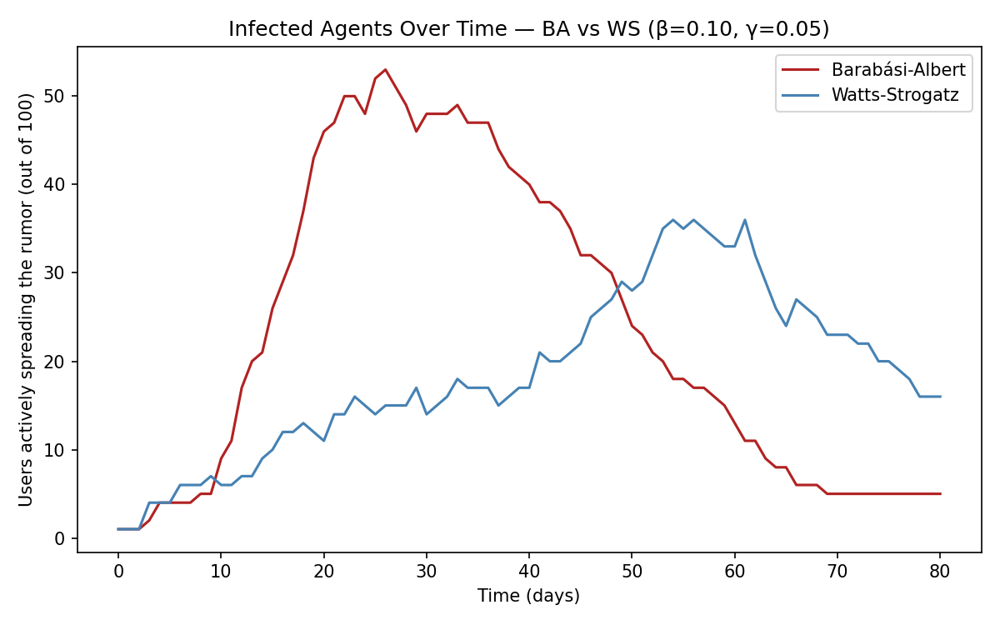

# Rumor spreading on a social network

An agent-based SIR simulation of how a rumor travels, run on two network
topologies that are structurally very different. Same parameters, same seed,
same number of people — and the peak arrives **28 days apart**.

Data and Signal Processing, Politehnica University of Bucharest (Erasmus+).

📄 [Full report](docs/report.pdf)

---

## The model

Each of the 100 agents is one person in a graph and is in one of three states:

- **S** — susceptible: has not heard the rumor
- **I** — infected: is actively spreading it
- **R** — recovered: has heard it and stopped passing it on

Every step, each spreader tells each susceptible neighbour with probability
`β = 0.10`, then stops spreading with probability `γ = 0.05`. The spreading
probability is taken from Vosoughi et al. (2018) on the diffusion of true and
false news online.

Two topologies, both with 100 nodes:

| Network | Generator | Shape |
|---|---|---|
| **Barabási-Albert** | `barabasi_albert_graph(n=100, m=2)` | scale-free — a few hubs with many connections, like influencers |
| **Watts-Strogatz** | `watts_strogatz_graph(n=100, k=4, p=0.1)` | small-world — everyone has a similar, local circle |

## Result

The rumor reaches the same kind of plateau in both networks, but not at the same
time. With hubs the peak of active spreaders lands around **day 26**; in the
closed, locally-connected network it arrives around **day 54**.



Hubs do not just add reach, they compress the schedule. For a financial rumor,
that month is the difference between correcting it while it still matters and
correcting it afterwards — which is the practical point of the whole exercise:
the intervention window is a property of the network, not of the rumor.

Full SIR curves per network and the summary metric chart are in
[`plots/`](plots/).

## Requirements

```bash
pip install -r requirements.txt
```

## Running it

```bash
python src/run.py
```

Runs both simulations with a fixed seed (42), writes the four figures to
`plots/` and prints the summary table: peak number of spreaders, day of the
peak, and final spread.

## Layout

```
src/model.py     RumorAgent and RumorModel (Mesa + NetworkX)
src/run.py       both simulations, figures and summary metrics
plots/           SIR curves per network, comparison and summary
docs/report.pdf  write-up
```

## Reference

Vosoughi, S., Roy, D. and Aral, S. (2018). *The spread of true and false news
online.* Science, 359(6380), 1146–1151.
